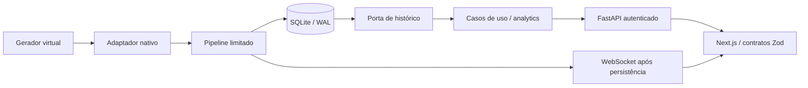

# Evolução enterprise — decisão executiva e implementação

Incremento visual posterior: pessoas/cães/gatos articulados, volume luminoso,
projeção isométrica, fullscreen e planta 2D implementados. São avatares sobre as
posições sintéticas existentes, não pose/espécie detectadas. Pesquisa de modelos
RF e análise das fontes fornecidas: docs/PEOPLE_ANIMALS_RF_RESEARCH.md.

15/10/2026, America/Fortaleza. Complemento subordinado ao
[plano normativo v3.0](docs/PROJECT_MASTER_PLAN.md).

Atualização de infraestrutura, 19:44 Fortaleza: Docker Desktop concluiu startup;
engine Linux 29.8.2 operacional. Stack e restart com persistência aprovados e
imagem Python 3.13 reconstruída/testada. Referências a Docker BLOCKED no diagnóstico
abaixo são históricas; evidência atual em docs/VERIFICATION_REPORT.md.

## Resultado e posicionamento

A plataforma é um laboratório local de eventos espaciais sintéticos com
FastAPI/SQLite/Next.js. Já oferece observatório 2D, streaming persistido,
analytics/replay, experimentos geométricos e regras dry-run. Esta entrega reforça
contratos, recuperação de erros e coerência visual. Não é um produto multiusuário
pronto para exposição pública; seu valor demonstrável está em engenharia de
eventos, rastreabilidade e operação reproduzível.

**Proposta comercial para a demo:** explorar cenários, entender decisões e
reproduzir evidências em uma plataforma local sem serviços pagos obrigatórios.
CTOs podem avaliar fronteiras, falhas e recuperação; recrutadores podem executar
um fluxo verificável. Mercado e disposição de compra ainda não foram pesquisados.
Gestão predial e avaliação de pipelines são hipóteses de uso, não clientes
validados. RF, vitais, sono, pose e identificação não são capacidades comerciais
comprovadas desta plataforma.

## Auditoria e decisões

| Domínio | Estado encontrado | Ação desta etapa | Limite / próxima decisão |
| --- | --- | --- | --- |
| Aquisição | domínio stdlib, relógio e adaptador próprios; legado opt-in | preservado | sem captura CSI/hardware |
| Evidência | Python mais restrito que schemas exportados e Zod; testes locais novos falhando | regenerar contratos; UUID compatível; união TS discriminada por versão; gate de drift | legado tolerante preservado; avaliador JSON Schema de testes é subset |
| Analytics | queries limitadas, histórico e export; fetch CSV duplicado | CSV usa cliente HTTP comum | offset/10k, sem rollups incrementais |
| Demo ao vivo | REST concorrente ao WS; close(1008) ilegal no browser; controle validava formulário em toda ação | merge temporal, close privado 4002, corpo validado apenas no start nativo | benchmark de latência/FPS ainda pendente |
| Transporte HTTP | mensagens genéricas e JSON inválido escapava como erro técnico | ApiError tipado; 422/429/503 acionáveis; parse sanitizado | não repetir automaticamente operações de escrita |
| API | respostas inesperadas 500 como texto | handler global JSON estável sem conteúdo de exceção | sem mascarar falha como sucesso; observabilidade por incidente é próximo incremento |
| Pesquisa geométrica | primeiro ponto da janela fora da sala ainda gerava velocidade | validar ambos os extremos de cada intervalo | não transforma geometria em inferência RF |
| UI | painéis secundários importados no bundle inicial | next/dynamic com loading acessível e condição de autenticação | sem alegar ganho percentual ou CWV medido |
| Infraestrutura | um worker, SQLite, Docker/scripts existentes | manter fronteiras e dados; validar o disponível | Docker daemon indisponível nesta execução |

## Arquitetura alvo e trade-offs

Manter **monólito modular hexagonal**. Não há benchmark ou necessidade operacional
que justifique Kafka, Kubernetes, microserviços ou migração imediata de banco.



O domínio define medidas e invariantes sem conhecer HTTP/SQLite. A aplicação
coordena casos de uso. As portas permitem injetar relógio e histórico; adaptadores
implementam I/O; `create_app` permanece composition root. DI deve separar fronteiras
úteis, sem criar interface para cada função. Não foi feita uma reorganização ampla
dos módulos funcionais nesta etapa.

Extrair `api/routers/{analytics,automation,model_lab,simulation}` em passos
posteriores, mantendo dependências de autorização no router e contratos/status
idênticos. Antes de extrair `Store`, separar portas de jobs e relatórios, com testes
de atomicidade/capacidade; remover acoplamento direto somente após prova de regressão.
Python contém APIs ainda pouco anotadas: tipagem estrita integral não foi entregue.
TypeScript continua strict; Ruff não é verificador estático de tipos Python.

SQLite/WAL e um escritor atendem o MVP local. Escala futura exige medir consulta,
fila e event loop, depois projetar cursor/índices/agregados. PostgreSQL autogerido
é uma possibilidade futura, com custo de administração e recursos locais, não
uma dependência desta entrega. Vários workers exigem estado compartilhado,
coordenação do scheduler e broker explícito; aumentar workers agora quebra a
semântica de sessões e filas em memória.

## Blocos críticos por domínio

Trechos resumidos do código efetivamente aplicado; arquivos são a referência
executável. Nenhum código do RuView foi transcrito para a implementação.

### Contratos e compatibilidade

```typescript
export const eventSchema = z.discriminatedUnion("schema_version", [
  internalEventSchema,
  ruviewEventSchema,
  nativeEventSchema,
]);
```

`apps/web/src/lib/contracts.ts` seleciona o validador pela versão, mantém
proveniência histórica tolerante e exige semente/cenário/dataset próprios em v2.
`z.guid()` aceita o formato UUID genérico emitido pelo backend; limites nativos
continuam restritos. `scripts/verify/export_contract.py --check` compara os 14
artefatos sem escrevê-los e agora integra o gate oficial.

### HTTP e experiência de erro

```typescript
export class ApiError extends Error {
  constructor(message: string, public status: number | null = null,
              public retryAfter: number | null = null) {
    super(message);
    this.name = "ApiError";
  }
}
```

`apps/web/src/lib/api.ts` centraliza fetch autenticado, timeout, erros de status,
leitura JSON validada e texto CSV. Não expõe o corpo arbitrário do erro servidor.
429 orienta espera quando Retry-After contém segundos numéricos limitados; não
reinicia operações automaticamente. Erros de sincronização só são removidos quando
o aviso atual corresponde à falha recuperada, preservando outros erros.

### WebSocket e controles

```typescript
export const STREAM_CONTRACT_CLOSE = 4002;
export function controlBody(action: string, provider: string, config: unknown) {
  if (action !== "start") return undefined;
  return provider === "RUVIEW_STREAM"
    ? "{}"
    : JSON.stringify(configSchema.parse(config));
}
```

O servidor pode enviar close 1008; o browser só pode iniciar close 1000 ou
3000–4999. A UI usa 4002 para contrato inválido e interrompe reconexão nesse caso.
Autenticação continua no primeiro frame. `mergeStatus` conserva a observação mais
recente da mesma fonte sem impedir mudanças de estado; null explícito limpa a
observação. `mergeHistory` deduplica por UUID e mantém 20 linhas. Regressões unitárias
comprovam os casos principais; exclusão/recarga continuam reconciliadas via API.

### API e erro inesperado

```python
@app.exception_handler(Exception)
async def unexpected_http_error(request: Request, error: Exception) -> JSONResponse:
    logging.getLogger("spatial.api").error("http failure type=%s", type(error).__name__)
    return JSONResponse(
        status_code=500,
        content={"detail": "internal service error"},
        headers={"Cache-Control": "no-store"},
    )
```

Não registra URL, payload, headers ou texto da exceção. O teste injeta erro com
conteúdo privado, exige JSON sanitizado/no-store e verifica health depois da falha.
O handler preserva HTTPException e suas respostas existentes. Falhas de tarefas
assíncronas continuam sob supervisão própria; handler HTTP não as resolve.

### Domínio geométrico

```python
if not 0 < delta <= 2 or not (
    0 <= x0 <= 8 and 0 <= y0 <= 6 and 0 <= x1 <= 8 and 0 <= y1 <= 6
):
    return None
```

`app/domain/motion.py` rejeita janelas com primeiro ponto inválido, além de lacunas
e valores não finitos. Unknown é uma abstenção; não produzir velocidade inválida.

## Demo comercial reproduzível

1. Bootstrap conforme README, iniciar com `scripts/dev/start.ps1`; conectar com
   token local em memória, sem colocá-lo em URL, gravação ou apresentação pública.
2. Mostrar `L0_SYNTHETIC`, seis sensores virtuais e iniciar cenário de movimento
   com semente 42. Explicar que posições vêm do gerador geométrico.
3. Pausar e demonstrar estabilidade dos eventos; consultar analytics, lacunas e
   variações líquidas. Não chamar variações de identificação individual.
4. Reproduzir histórico, salvar relatório e exportar CSV/JSON da página, com
   período/end fixo para comparações. Não apagar o histórico para preparar demo.
5. Executar experimento geométrico; mostrar split por sessão, matriz e rejeição.
   Não anunciar acurácia RF a partir dos dados sintéticos.
6. Criar regra dry-run, observar decisão e revogar. Não há despacho externo.
7. Mostrar relatório de testes e limites, encerrar a simulação e sair. Reinício
   com persistência só deve ser demonstrado sobre base isolada do roteiro de testes.

Tour guiado interativo, comparação de cenários, pacote exportável de evidências e
observabilidade são próximos incrementos de produto; não aparecem como entregues.

## Qualidade, fontes e critérios de promoção

Validação desta entrega: 175 testes backend, seis de launchers e 21 web; lint,
tipos TypeScript, contratos e build aprovados. Último frontend validado com 14 E2E
Chromium/Firefox (51,4 s); dois legados skipped. npm e dois locks Python auditados
sem vulnerabilidades conhecidas. Docker/Python 3.13 atuais BLOCKED por daemon
indisponível. Evidências detalhadas e falhas intermediárias estão no relatório.

O catálogo detalhado está em [RUVIEW_FEATURES_ANALYSIS](RUVIEW_FEATURES_ANALYSIS.md),
com revisão fixada e distinção de capacidades declaradas, código e validação.
Exposição ao código foi registrada: não alegamos clean-room estrita. A demo padrão
continua independente do upstream e todos os dados permanecem `L0_SYNTHETIC`.

Plano de ferramentas gratuitas e fontes primárias: [ROADMAP_AND_SKILLS](ROADMAP_AND_SKILLS.md).
Gates e falhas reais: [VERIFICATION_REPORT](docs/VERIFICATION_REPORT.md).
Próximas entregas e critérios: [TASKS](TASKS.md).

Critérios para uma oferta enterprise futura: autenticação por principal e RBAC,
autorização por ambiente, TLS e ameaça de rede revistos, políticas de consentimento,
recovery testado, carga medida, acessibilidade assistiva e contratos estáveis.
Isso exige implementação e validação adicional, não apenas documentação.
